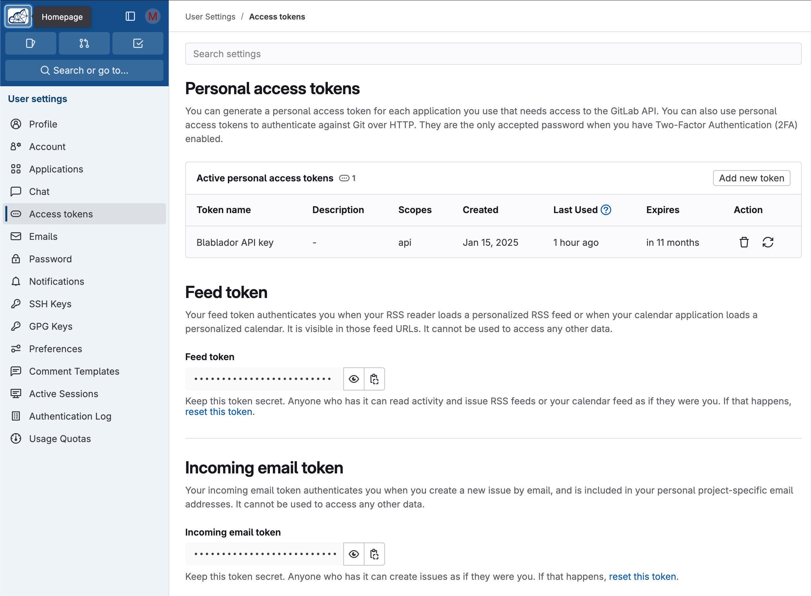

# Preparation

> **Make sure to complete these steps several days before the training session.  
> If you run into problems, contact the trainer via [email](mailto:matthias.taeschner@uni-leipzig.de?subject=JupyterLab%20AI%20Training%20Preparation).**

## 1. Access to an LLM endpoint

The AI assistant we want to use connects to a Large Language Model (LLM) through an **OpenAI-compatible API**. For the training you need to set the following variables in the file `secrets` (also see below):

* the **endpoint URL** of such an API (`ENDPOINT_URL`)
* a personal **API key** (`OPENAI_API_KEY`)
* the names of two models offered by the endpoint:
  * a general-purpose model (`LLM_MODEL`) 
  * a model specialised in coding (`LLM_MODEL_CODER`)

### Registration at Helmholtz Blablador

Helmholtz-Jülich provides a LLM service with such an OpenAI-compatible API called "[Blablador](https://helmholtz-blablador.fz-juelich.de/)". Blablador can be used free of charge by members of German research institutions with a Helmholtz ID - generally, the respective university login works. In order to use the API service, prior registration and the generation of an Access Token / API key are necessary.

Please follow the steps on [this website](https://sdlaml.pages.jsc.fz-juelich.de/ai/guides/blablador_api_access/) as described:

1. **Register at Helmholtz Gitlab (Codebase)**
* Open the [Helmholtz Codebase](https://codebase.helmholtz.cloud/users/sign_in)
 * Log in via "Helmholtz ID" and select your university to authenticate with your university account
2. **Create an API Key (Access Token)**
* _ATTENTION: this API key should be treated like a personal password and should not be made available to anyone else! A password manager is a good place for it._
* Open your [profile page](https://codebase.helmholtz.cloud/-/profile/preferences)
* Select "Access Token" on the left side
* Under "Personal access tokens", create a new token via "Add new token"
* Name it best "Blablador API key"
* Select "api" as scope
* Copy the displayed key and save it securely (e.g. password manager) - it will not be displayed again after confirmation



* With a valid Blablador API key, those are the working values for the variables in the file `secrets` mentioned above:
  * `ENDPOINT_URL`: https://api.blablador.fz-juelich.de/v1/
  * `OPENAI_API_KEY`: _your-blablador-access-token_
  * `LLM_MODEL`: alias-fast
  * `LLM_MODEL_CODER`: alias-code

## Optional: Zenodo Sandbox token

Only needed if you want to run the deposit in notebook 7 yourself. Otherwise you follow the trainer's live demo.

1. Register at <https://sandbox.zenodo.org>. This is a test instance and *separate* from the real zenodo.org.
2. Create a personal access token: *Applications → Personal access tokens → New token*, with the scopes `deposit:write` and `deposit:actions`.

## 2. Prepare your laptop

The practical work is done locally on your laptop.

### What you need

* Your laptop with internet access
* Administration rights to install software
* A terminal:
  * **Windows**: Command Prompt or PowerShell
  * **macOS** / **Linux**: Terminal

### Install uv

[`uv`](https://docs.astral.sh/uv/) is a fast tool for Python project and package management. Install it as described in the [uv documentation](https://docs.astral.sh/uv/getting-started/installation/). Then close and reopen your command prompt / terminal, and verify (should print the installed version):

```bash
uv --version
```

If Python is already installed on your system, `uv` uses it. Otherwise, `uv` [downloads a suitable Python version automatically](https://docs.astral.sh/uv/guides/install-python/#automatic-python-downloads).

### Download and unpack the training materials

* Download [`jupyter-ai-rdm-training.zip`](jupyter-ai-rdm-training.zip) and unpack it. You get a folder `jupyter-ai-rdm-training/` with:
  * file `pyproject.toml` - the list of Python packages needed for the training
  * file `secrets` - a template for your personal local settings
  * folders `notebooks/`, `data/`, `checkpoints/`, `examples/`

> **Do not use cloud-synced or network folders**  
Do **not** place the folder inside OneDrive, Dropbox, Google Drive, iCloud or on a network drive. On many managed laptops these locations restrict running programs and keep syncing files. This can block or corrupt the Python environment, so that `uv sync` or `uv run` fails or hangs.

Use a plain **local** folder instead, e.g. `C:\Users\<you>\jupyter-ai-rdm-training` (Windows) or `~/jupyter-ai-rdm-training` (macOS/Linux).

### Create the Python virtual environment

Open the terminal, go into the unpacked folder, and install all packages:

```bash
cd /path/to/jupyter-ai-rdm-training
uv sync
```

This creates a local virtual environment in a hidden folder `.venv` and a file `uv.lock` with the exact package versions.

### Fill in your `secrets` file

Open the file `secrets` in a text editor and fill in:

* `ENDPOINT_URL`, `OPENAI_API_KEY`, `LLM_MODEL`, `LLM_MODEL_CODER` - see step 1
* `ZENODO_SANDBOX_TOKEN` - optional, see step 1

Leave `SYSTEM_PROMPT_DATA_STEWARD` as provided.

> **NOTE:** Never share the `secrets` file or commit it to a git repository.

### Start JupyterLab with your secrets

From the `jupyter-ai-rdm-training/` folder, start JupyterLab so that it loads `secrets` as environment variables:

```bash
uv run --env-file=secrets jupyter lab
```

* Your browser opens JupyterLab. If it doesn't, copy the URL shown in the terminal (starting with `http://localhost:8888/lab?token=...`) into your browser.
* To stop JupyterLab, press `Ctrl + C` in the terminal.

### Run the setup check

In JupyterLab, open `notebooks/0_setup-check.ipynb` and run `Kernel > Restart Kernel and Run All Cells...`.

> **If every check prints ✅: Congratulations!** You are ready for the training.

## 3. Recommended: basics of Python and the terminal

No extensive programming knowledge is required, but the training uses Python and the terminal. If you are new to them, these interactive resources help:

* <https://www.w3schools.com/python/>
* <https://futurecoder.io/course/>
* <https://www.terminaltutor.com/>
